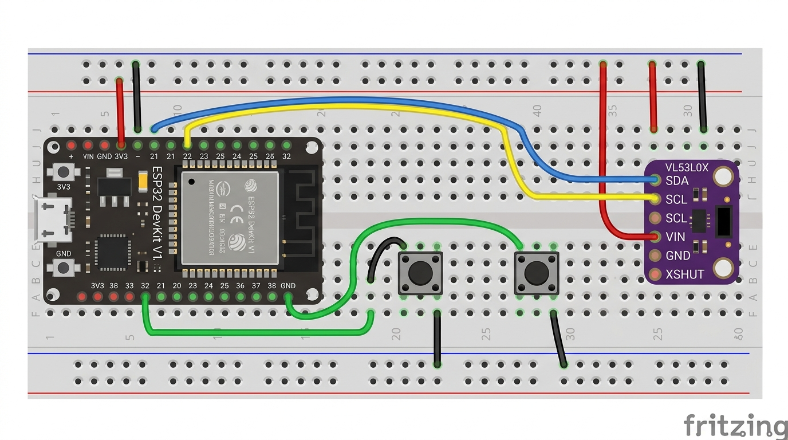

# Drishti ESP32 + VL53L0X — Breadboard Wiring

Board: **ESP32 DevKit V1** (30-pin, USB-UART bridge)
Sensor: **VL53L0X** time-of-flight range finder
Inputs: **3 momentary push buttons** to ground

> The pin table below is the source of truth. Generated images often garble
> labels — always verify against this table before applying power.

> **Prototype only:** this wiring covers the current single-zone VL53L0X breadboard. It is not the wiring for the future multizone/downward redundant sensor architecture described in [`../../docs/INDUSTRY_ROADMAP.md`](../../docs/INDUSTRY_ROADMAP.md). Disconnect USB power before changing wiring, verify breakout voltage requirements, and do not use a breadboard assembly in human trials.

---

## 1. Bill of materials

| Qty | Part | Notes |
|----:|------|-------|
| 1 | ESP32 DevKit V1 | CP2102 or CH340 USB-UART |
| 1 | VL53L0X breakout | 4-pin: VIN, GND, SDA, SCL (some label VCC/VDD) |
| 2 | Momentary push buttons | 4-leg tactile switches |
| 1 | Breadboard | 830-point, with power rails |
| — | Jumper wires | red / black / blue / yellow / green |
| 1 | USB **data** cable | Charge-only cables will not enumerate |
| 2 | 100 nF capacitors *(optional)* | Across each button for extra debounce |

---

## 2. Pin map

| ESP32 DevKit V1 | Connect to | Wire colour | Why |
|---|---|---|---|
| **3V3** | VL53L0X **VIN** | red | 3.3 V rail. Never feed 5 V into a bare 3.3 V module |
| **GND** | VL53L0X **GND** | black | Common ground |
| **GPIO21 (D21)** | VL53L0X **SDA** | blue | I²C data |
| **GPIO22 (D22)** | VL53L0X **SCL** | yellow | I²C clock |
| **3V3** | VL53L0X **XSHUT** | red | Keeps the sensor enabled |
| **GPIO32 (D32)** | Button 1 → **GND** | green | Narration (Scene Understanding) |
| **GPIO33 (D33)** | Button 2 → **GND** | green | Currency Identification |
| **GPIO25 (D25)** | Button 3 → **GND** | green | Text / Document Reading |
| **USB** | Laptop | — | Power + serial (`/dev/ttyUSB0`) |

Leave **GPIO1** on the VL53L0X unconnected.

### Pins to avoid

| Pins | Reason |
|---|---|
| GPIO0, 2, 12, 15 | Boot-strapping pins — a button here can prevent boot |
| GPIO6–11 | Connected to the SPI flash |
| GPIO34–39 | Input-only, **no internal pull-ups** |

---

## 3. Diagram



```
                 ESP32 DevKit V1                     VL53L0X breakout
               ┌────────────────┐                   ┌────────────────┐
               │                │                   │                │
    3V3  ●─────┤ 3V3        VIN ├───────────────────┤ VIN            │
    GND  ●─────┤ GND        GND ├───────────────────┤ GND            │
 GPIO21  ●─────┤ D21        SDA ├───────────────────┤ SDA            │
 GPIO22  ●─────┤ D22        SCL ├───────────────────┤ SCL            │
    3V3  ●─────┤ 3V3      XSHUT ├───────────────────┤ XSHUT          │
               │                │                   │ GPIO1   (nc)   │
 GPIO32  ●──[BTN1]──GND         │                   └────────────────┘
 GPIO33  ●──[BTN2]──GND         │
               │  USB ●─────────┼──── laptop  →  /dev/ttyUSB0
               └────────────────┘
```

Button wiring, seen from above:

```
   GPIO32 ●──────┐                 GPIO33 ●──────┐
                 │                                 │
              ┌──┴──┐                           ┌──┴──┐
              │ BTN │  one leg to GPIO          │ BTN │
              └──┬──┘  other leg to GND         └──┬──┘
                 │                                 │
   GND rail ●────┘                 GND rail ●──────┘
```

---

## 4. Breadboard layout, step by step

1. **Seat the ESP32** across the centre channel so the USB connector overhangs
   one edge and both pin rows sit in separate halves of the board.
2. **Bridge the power rails.** Most 830-point boards split the top and bottom
   rails in the middle. Add a short jumper across each gap so the whole rail
   is one net.
3. **Run the 3V3 rail.** Red jumper from the ESP32 `3V3` pin to the red rail.
4. **Run the ground rail.** Black jumper from an ESP32 `GND` pin to the blue/
   black rail.
5. **Place the VL53L0X** near the ESP32 (same end of the board) so the I²C
   leads stay shorter than ~20 cm.
6. **Wire the sensor** with four short jumpers:
   `3V3 → VIN`, `GND → GND`, `GPIO21 → SDA`, `GPIO22 → SCL`.
7. **Tie XSHUT high** with a short red jumper from the sensor's XSHUT to the
   3V3 rail.
8. **Place the two buttons** across the centre channel, below the ESP32.
9. **Wire each button**: one leg to `GPIO32` / `GPIO33`, the other leg to the
   ground rail. Do not share the GPIO row with anything else.
10. **Inspect before powering:** no red wire touching a black rail, no jumper
    in the ESP32's USB end, sensor VIN on 3V3 (not VIN/5V).
11. **Plug in a data-capable USB cable.** The board should enumerate as
    `/dev/ttyUSB0` (CP2102/CH340) or `/dev/ttyACM0` (native USB).

### Optional: hardware debounce

Fit a 100 nF capacitor directly across each button's two legs. The firmware
already debounces for 30 ms, so this is only needed if you see double presses.

---

## 5. Flash the firmware

### PlatformIO (recommended)

```bash
cd firmware/drishti_tof
pio run -t upload
pio device monitor -b 921600
```

### Arduino IDE

- Board: **ESP32 Dev Module**
- Upload speed: **921600**
- Port: `/dev/ttyUSB0`
- Library Manager: install **VL53L0X by Pololu**
- Open `drishti_tof.ino`, upload, then open Serial Monitor at **921600**.

### Linux serial permissions

```bash
sudo usermod -aG dialout "$USER"
# log out and back in, then:
ls -l /dev/ttyUSB0
```

---

## 6. Verify

Expected serial output (one range line every ~20–30 ms):

```
I,1.0.0,VL53L0X
D,1,1234,842,845,0,0
D,2,1261,840,838,0,0
S,38.4,0.0,1,1
```

Press each button and confirm:

```
B,1,5321,1
B,1,5350,0
```

Probe from Python (no full pipeline needed):

```bash
python scripts/probe_esp32.py --port /dev/ttyUSB0
```

Cover the sensor with your hand at 0.2 m, 0.5 m, 1.0 m and 1.5 m and confirm
the reported millimetres track reality within a few centimetres.

---

## 7. Troubleshooting

| Symptom | Likely cause | Fix |
|---|---|---|
| `/dev/ttyUSB0` missing | charge-only cable, or no CH340/CP2102 driver | use a data cable; `dmesg | tail` |
| `E,1,sensor_init_failed` | SDA/SCL swapped, no 3V3, XSHUT low | recheck wires; tie XSHUT to 3V3 |
| Sensor reads 8190 repeatedly | no target / too far / black surface | aim at a matte target within 2 m |
| Distance jumps wildly | ambient IR / shiny target | lower ambient light; add a 5-sample median (already in firmware) |
| Buttons repeat | floating input or long wires | confirm `INPUT_PULLUP`; add 100 nF |
| Windows/macOS port name | different OS naming | `--port COM5` / `/dev/tty.usbserial-*` |

---

## 8. Image-generation prompt

Paste this into an image model (DALL·E, Midjourney, SDXL, etc.). Use the pin
table above as the authority, not the generated text.

> **Prompt:**
> Photorealistic top-down instructional diagram of a breadboard electronics
> setup on a clean white background, studio lighting, sharp focus.
> A 30-pin ESP32 DevKit V1 development board straddles the centre channel of a
> white 830-point solderless breadboard, its USB connector overhanging the left
> edge. To the right of the ESP32 sits a small purple VL53L0X time-of-flight
> sensor breakout board with four pins labelled VIN, GND, SDA, SCL.
> Four short jumper wires run between them: a red wire from the ESP32 3V3 pin
> to the sensor VIN, a black wire from ESP32 GND to sensor GND, a blue wire
> from GPIO21 to SDA, and a yellow wire from GPIO22 to SCL. A short red jumper
> ties the sensor XSHUT pin to the 3V3 rail.
> Below the ESP32, two small black tactile push buttons straddle the centre
> channel. Each button has one leg connected by a green wire to GPIO32 and
> GPIO33 respectively, and its other leg connected to the black ground rail.
> Red and black power rails run along the top and bottom of the breadboard.
> Clean technical illustration style, high contrast, no extra components, no
> loose wires, no text other than the pin labels, accurate wiring.
>
> **Negative prompt:** extra boards, extra sensors, tangled wires, wrong pin
> labels, short circuit, red wire to ground, 5V to sensor, blurry, watermark.

**Reality check after generating:** confirm (1) sensor VIN is on **3V3**, not
5V; (2) SDA is on **GPIO21** and SCL on **GPIO22**; (3) XSHUT is high;
(4) buttons go to **GPIO32/GPIO33** and **GND**, not to the 3V3 rail.
